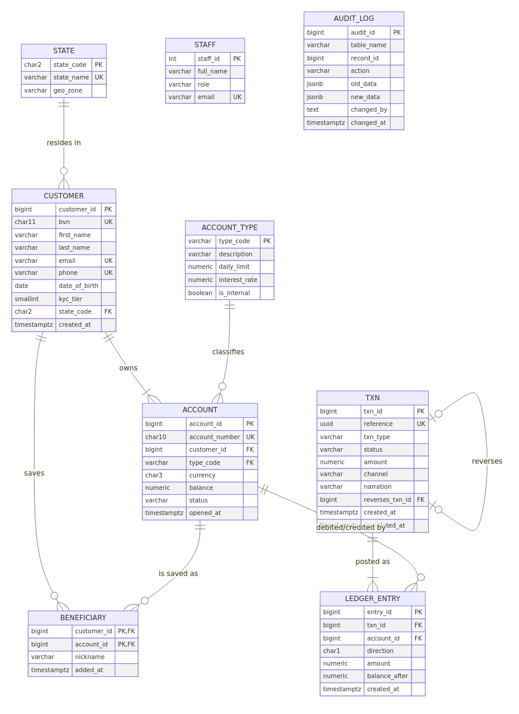

**GitHub repository:** <https://github.com/iamroyalmayor/mit8103-advanced-database-portfolio> (private; assessor added as collaborator)

## 1. Selected organisation

**NairaFlow Digital Bank** is a simulated Nigerian mobile-first bank. Customers open savings or
current accounts after BVN-based KYC (tiers 1–3) and move money through the mobile app, USSD, web,
POS, ATM and branch channels. **Users:** customers, tellers, customer-support staff, auditors and
compliance, operations and regulatory reporting. **Major data:** customers, accounts, transactions,
a double-entry ledger, beneficiaries, staff and an audit trail. **Key operations:** deposit,
withdraw, transfer funds atomically, reverse failed or disputed transactions, statements,
reconciliation, money-mule detection, and failed-transaction and dormancy reports. A bank was chosen
because it makes every advanced topic concrete: a lost update here is lost money.

## 2. Portfolio 1 – Database design and modelling

A 9-table schema (state, account_type, customer, account, txn, ledger_entry, beneficiary, staff,
audit_log), normalised from a flat statement layout through 1NF/2NF/3NF to **BCNF**. The core idea
is a **double-entry ledger**: every transaction has debit and credit legs that must balance, which a
`DEFERRABLE INITIALLY DEFERRED` constraint trigger checks at COMMIT. Keys combine surrogate identity
PKs with natural candidate keys (BVN, NUBAN, e-mail, phone, transaction UUID used as an idempotency
key), a composite PK for the M:N beneficiary relationship, and a recursive FK for reversals.
CHECK constraints enforce the phone format, minimum age, the no-overdraft rule (except internal GL
accounts) and the reversal link. `transfer_funds()` and `reverse_transaction()` hold the business
logic. **Evidence:** ER diagram, DDL, and 13 validation tests, each rejected by the expected
constraint; Σ of all balances = 0.00.

{width=55%}

## 3. Portfolio 2 – Query processing and optimisation

The schema was loaded with **60 k customers, 100 k accounts, 1.1 M transactions and about 2.1 M
ledger rows**. Seven workload queries were run with `EXPLAIN (ANALYZE, BUFFERS)` before and after
indexing:

| Query | Before (ms) | After (ms) | Index used |
|---|---:|---:|---|
| Q1 account statement | 333.6 | 0.23 | composite (account_id, created_at DESC) |
| Q2 e-mail lookup | 74.7 | 0.04 | expression `lower(email)` |
| Q3 failed-txn dashboard | 181.7 | 13.7 | partial `WHERE status='FAILED'` |
| Q4 top senders (7 days) | 529.2 | 173.3 | covering `INCLUDE (...)` (index-only) |
| Q5 mule detection | 503.3 | 196.5 | covering + `uq_leg` |
| Q6 reconciliation | 11,101.5 | 0.62 | composite (LATERAL `LIMIT 1`) |
| Q7 dormant accounts | 575.3 | 436.4 | anti-join; needs a design change, not an index |

Each index was chosen from the plan: a composite B-tree (equality column, then range/sort
column) removed a Seq Scan *and* a Sort for statements; an **expression index** made
`lower(email)` searchable; a **partial index** covers only FAILED rows; a **covering index** with
`INCLUDE` gave index-only scans. The largest gain (Q6) turned a correlated LATERAL lookup from 50
full scans into 50 index probes. Index cost (space and write amplification) is discussed in the
README. **Monthly range partitioning** pruned 14 of 15 partitions (672 ms → 101 ms)
and enabled `DETACH PARTITION` archiving.

## 4. Portfolio 3 – Transactions and concurrency

Single-session demos show COMMIT, ROLLBACK, automatic rollback of a failed transaction, SAVEPOINT
partial rollback, and idempotent retries. Two-session scenarios, synchronised and time-stamped,
reproduce: a **lost update** at READ COMMITTED (₦30,000 vanished); its fixes, `SELECT … FOR UPDATE`
(B blocked until A committed) and REPEATABLE READ (serialization failure, so retry); **write skew**
that REPEATABLE READ allows (the combined-balance rule was violated) but **SERIALIZABLE (SSI)
prevents**; and a **deadlock** with its fix, global lock ordering. A pgbench stress test (16
clients, 50 hot accounts) showed naive read-modify-write **creating money** (Σ ≠ 0), while
`transfer_funds()` processed 21,864 transfers (≈ 1,450 tps) with **0 failures, Σ = 0.00 and every balance
matching the ledger**.

## 5. Portfolio 4 – NoSQL and advanced data models

**MongoDB:** customers embed bounded KYC documents, devices and beneficiaries; accounts are
referenced (hot, frequently updated); transactions embed their ledger legs, so a posting is a single
atomic document write; a **bucket pattern** stores one statement document per account-month.
`$jsonSchema` validation, Decimal128 money, multikey and partial indexes cut account-history scans
from 157,974 to 13 documents (≈ 400 ms → 5 ms). A multi-document transaction (`withTransaction`,
snapshot / majority) committed one transfer and rolled back three failure cases. **Redis** handles
sessions (TTL), OTP rate limiting, idempotency keys (`SET NX`), a balance cache, sorted-set
leaderboards and HyperLogLog fraud counters. A Neo4j Cypher design covers multi-hop mule rings.
**Conclusion:** polyglot persistence, with PostgreSQL as the system of record.

## 6. Portfolio 5 – Distributed and cloud databases

With Docker Compose: a **PostgreSQL primary plus a streaming hot standby** (replication slot). The
replica rejects writes, replication lag was measured under a 200 k-row burst, **synchronous commit**
blocked writes when the standby was down (CAP: consistency chosen over availability), and
**failover** promoted the replica, which kept every committed transfer. A **3-node MongoDB replica
set** elected a new primary in about 11.5–12 s after the primary was killed; `w:majority` writes
continued and the old primary rejoined as a secondary. A `w:5` write returned an error yet was still applied: a write-concern error means "unknown outcome", not "rolled back". A shard-key simulation showed HASH(customer_id)
spreading data evenly with single-shard statements, while RANGE(created_at) would create a write
hot spot. A cloud design (Multi-AZ PostgreSQL, MongoDB Atlas, Redis, CDC, NDPA 2023 data
residency, RPO 0 / RTO < 60 s) is in `cloud-architecture.md`.

## 7. Individual technical reflection

> _Draft for you to rewrite in your own words. The assessor marks this as evidence of
> **your** understanding (3 marks)._

**Design choices.** I chose a double-entry ledger over simply updating balances, because it makes
correctness *checkable*: Σ balances must be zero and every transaction must balance. That
check later exposed real bugs. I kept a stored `balance` for O(1) authorisation and accepted
that controlled redundancy, reconciling it against the ledger.

**Challenges.** (1) The pgbench test failed at first because the stored functions resolved table
names through the caller's `search_path`. Pinning `SET search_path` on every function fixed it and
also closes a known security hole. (2) After the stress test, a few accounts' last ledger row did not
match the balance. The cause was `now()`, which returns the *transaction start* time, so a
transfer that waited for a row lock was stamped earlier than the transfer it queued behind. Using
`clock_timestamp()` after the locks are acquired fixed the ordering. (3) Making two-session
experiments reproducible required synchronising on `pg_stat_activity` instead of fixed sleeps.

**Lessons learned.** Isolation levels are not abstract: READ COMMITTED silently lost money, and
only SERIALIZABLE caught write skew. Indexes must be justified from execution plans and paid for
in write cost. Distribution is a set of trade-offs (synchronous replication gives RPO 0 but can
block writes). Document databases excel at read-shaped aggregates but push integrity rules into
code.

## References

- Cahill, M. J., Röhm, U. and Fekete, A. D. (2008) 'Serializable isolation for snapshot databases', *Proc. ACM SIGMOD*, pp. 729–738.
- Connolly, T. and Begg, C. (2015) *Database Systems: A Practical Approach to Design, Implementation, and Management*. 6th edn. Pearson.
- Elmasri, R. and Navathe, S. B. (2016) *Fundamentals of Database Systems*. 7th edn. Pearson.
- Kleppmann, M. (2017) *Designing Data-Intensive Applications*. O'Reilly Media.
- Abadi, D. (2012) 'Consistency tradeoffs in modern distributed database system design: CAP is only part of the story', *IEEE Computer*, 45(2), pp. 37–42.
- PostgreSQL Global Development Group (2025) *PostgreSQL 16 Documentation*: chapters 11 (Indexes), 13 (Concurrency Control), 14 (Performance Tips), 5.11 (Table Partitioning), 27 (High Availability and Replication). https://www.postgresql.org/docs/16/
- MongoDB Inc. (2025) *MongoDB 7.0 Manual*: Data Modeling, Schema Validation, Transactions, Replication. https://www.mongodb.com/docs/v7.0/
- Redis Ltd. (2025) *Redis Documentation*: data types, EXPIRE, HyperLogLog. https://redis.io/docs/
- Federal Republic of Nigeria (2023) *Nigeria Data Protection Act, 2023*.
- Central Bank of Nigeria (2023) *Guidelines on Operations of Bank Accounts* and AML/CFT regulations.
