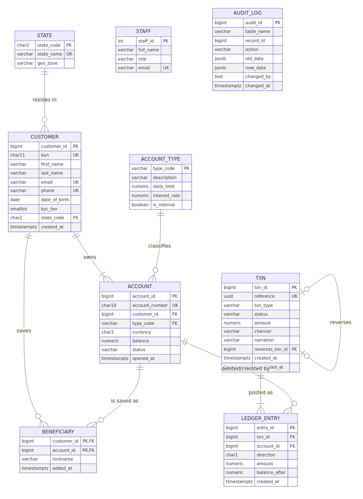

<div align="center">

<h1>NairaFlow | Database Design &amp; Modelling</h1>

<p><strong>Portfolio 1 · MIT 8103 Advanced Database Systems</strong></p>

<p>A relational database design for a simulated Nigerian mobile-first digital bank.</p>

<p><a href="#1-design-goals">Design</a> · <a href="#2-entity-relationship-diagram">ER diagram</a> · <a href="#3-relational-schema">Schema</a> · <a href="#5-constraints-and-business-rules">Constraints</a> · <a href="#8-run-and-test">Run it</a></p>

</div>

> **Case study:** NairaFlow Digital Bank  
> Money movement is modelled with an auditable double-entry ledger, enforceable business rules, and reversible transactions. See the [portfolio overview](../README.md#case-study-nairaflow-digital-bank) for the full organisation statement.

| **9** relational entities | **BCNF** schema | **13** validation tests | **PostgreSQL 16** |
|:---:|:---:|:---:|:---:|
| Customers, accounts, ledger and more | Normalised with deliberate exceptions | Constraints and business rules exercised | Schema, seed data and tests |

## Contents

- [1. Design goals](#1-design-goals)
- [2. Entity-relationship diagram](#2-entity-relationship-diagram)
- [3. Relational schema](#3-relational-schema)
- [4. Key strategy](#4-key-strategy)
- [5. Constraints and business rules](#5-constraints-and-business-rules)
- [6. Normalisation](#6-normalisation)
- [7. Controlled denormalisation](#7-controlled-denormalisation)
- [8. Run and test](#8-run-and-test)
- [9. Evidence](#9-evidence)

## 1. Design goals

| Requirement | Design response |
|---|---|
| Money must never be created or lost; every movement must be auditable | **Double-entry ledger:** every transaction has at least two `ledger_entry` legs whose debits equal credits, enforced by a deferred constraint trigger |
| A customer may hold several savings or current accounts | One-to-many `customer → account` relationship |
| Customers can save other accounts as beneficiaries | Many-to-many relationship resolved by the `beneficiary` associative entity |
| Failed transfers must be reversible, with a link to the original | Recursive one-to-one `txn.reverses_txn_id → txn` relationship |
| Network retries must not double-debit a customer | Unique `txn.reference` UUID used as an idempotency key |
| KYC tiers and BVN identity must be validated | Unique `customer.bvn`, regex validation, and `kyc_tier` constrained to 1–3 |
| Regulators and auditors need change history | Triggers populate `audit_log` with old and new row images as JSONB |

## 2. Entity-relationship diagram



The diagram source is [`diagrams/er-diagram.mmd`](diagrams/er-diagram.mmd); an SVG copy is also available in the same folder.

## 3. Relational schema

The underlined attribute in each relation is its primary key; `*` marks a foreign key.

- `STATE`(<u>state_code</u>, state_name, geo_zone)
- `ACCOUNT_TYPE`(<u>type_code</u>, description, daily_limit, interest_rate, is_internal)
- `CUSTOMER`(<u>customer_id</u>, bvn, first_name, last_name, email, phone, date_of_birth, kyc_tier, *state_code*, created_at)
- `ACCOUNT`(<u>account_id</u>, account_number, *customer_id*, *type_code*, currency, balance, status, opened_at)
- `TXN`(<u>txn_id</u>, reference, txn_type, status, amount, channel, narration, *reverses_txn_id*, created_at, completed_at)
- `LEDGER_ENTRY`(<u>entry_id</u>, *txn_id*, *account_id*, direction, amount, balance_after, created_at)
- `BENEFICIARY`(<u>*customer_id*, *account_id*</u>, nickname, added_at)
- `STAFF`(<u>staff_id</u>, full_name, role, email)
- `AUDIT_LOG`(<u>audit_id</u>, table_name, record_id, action, old_data, new_data, changed_by, changed_at)

See the complete DDL in [`sql/01_schema.sql`](sql/01_schema.sql).

## 4. Key strategy

| Key type | Where it is used | Why |
|---|---|---|
| **Surrogate primary keys** (`GENERATED ALWAYS AS IDENTITY`) | `customer`, `account`, `txn`, `ledger_entry`, `staff`, `audit_log` | Compact, stable identifiers that are efficient to join and index |
| **Natural candidate keys** (`UNIQUE`) | `bvn`, `email`, `phone`, `account_number` (10-digit NUBAN), `txn.reference` | Preserve uniqueness of business identifiers without making them primary keys; for example, a corrected BVN does not require cascading key updates |
| **Composite primary key** | `beneficiary(customer_id, account_id)` | Prevents the same beneficiary from being saved twice |
| **Composite unique key** | `ledger_entry(txn_id, account_id, direction)` | Prevents a transaction from debiting the same account twice |
| **Foreign keys** | 8 relationships | `ON DELETE RESTRICT` protects financial history on customer-to-account relationships; `ON DELETE CASCADE` is limited to `beneficiary`, which has no history value |

## 5. Constraints and business rules

| Rule | Enforcement | Validation evidence |
|---|---|---|
| Phone matches `+234XXXXXXXXXX` | Regex `CHECK` constraint | T2 |
| Customer is at least 18 | `CHECK` constraint | T3 |
| Customer accounts cannot go below zero; internal GL accounts can | `CHECK (balance >= 0 OR type_code = 'GL')` | T5 |
| Transaction amount is greater than zero | `CHECK` constraint | T6 |
| A `REVERSAL` must reference the transaction it reverses, and only a `REVERSAL` may do so | `CHECK ((txn_type = 'REVERSAL') = (reverses_txn_id IS NOT NULL))` | T7 |
| Debits equal credits for each transaction | Deferred constraint trigger, checked at commit | T8 |
| A customer with accounts cannot be deleted | Foreign key with `RESTRICT` | T9 |
| Insufficient funds and frozen accounts are rejected | `transfer_funds()` logic | T10, T11 |
| Only completed transactions can be reversed, and only once | `reverse_transaction()` logic | T12, T13 |

Two stored functions implement the transfer and reversal workflows:

- **`transfer_funds()`** checks idempotency, locks both account rows in a fixed order to prevent deadlocks (see Portfolio 3), validates account status and balance, then writes the transaction header, both ledger legs, and both balances atomically.
- **`reverse_transaction()`** posts mirror-image ledger legs, links the reversal to the original transaction, and marks the original `REVERSED`.

## 6. Normalisation

**Starting point (UNF).** A typical bank-statement spreadsheet row might contain:

```text
(account_no, customer_name, bvn, phone, state, geo_zone, account_type, daily_limit,
 {txn_ref, date, channel, counterparty_acct, amount, direction}...)
```

### 1NF — remove repeating groups

Give each transaction its own row with atomic values:

```text
STATEMENT_LINE(account_no, txn_ref, customer_name, bvn, phone, state, geo_zone,
               account_type, daily_limit, date, channel, counterparty_acct, amount, direction)
Key: (account_no, txn_ref)
```

### 2NF — remove partial dependencies

- `account_no → customer_name, bvn, phone, state, geo_zone, account_type, daily_limit` depends on only part of the composite key, so these attributes move to `ACCOUNT`.
- `txn_ref → date, channel, amount` moves to `TXN`.
- `(account_no, txn_ref) → direction, amount` becomes `LEDGER_ENTRY` (one leg).

### 3NF — remove transitive dependencies

- In `ACCOUNT`, `account_no → bvn → customer_name, phone, state` is transitive, so customer details move to `CUSTOMER` (keyed by a surrogate, with BVN as a candidate key).
- In `CUSTOMER`, `state_code → state_name, geo_zone` is transitive, so state details move to `STATE`.
- In `ACCOUNT`, `account_type → daily_limit, interest_rate` is transitive, so account-type details move to `ACCOUNT_TYPE`.

### BCNF check

In every table, each non-trivial functional dependency has a superkey on its left side. `CUSTOMER` has several candidate keys (`customer_id`, `bvn`, `email`, `phone`), and each determines the whole row. The schema therefore satisfies BCNF.

## 7. Controlled denormalisation

These deliberate exceptions are documented and reconciled:

1. **`account.balance`** can be derived from the ledger (Σ credits − Σ debits). It is stored so that the balance check on every transfer is O(1). It is only changed inside `transfer_funds()` and `reverse_transaction()`. Portfolio 2 query Q6 and the Portfolio 3 stress tests reconcile it against the ledger.
2. **`ledger_entry.balance_after`** is a running balance stored for statements. It is append-only and never updated.
3. **`audit_log.old_data/new_data`** are historical JSONB snapshots, not live data, so they do not create update anomalies.

## 8. Run and test

Requirements: Docker and a Bash shell. On Windows, use Git Bash.

```bash
bash ../scripts/start_postgres.sh   # PostgreSQL 16 in Docker (container nf-pg)
bash run.sh                          # schema + seed + validation tests -> evidence/
```

## 9. Evidence

| File | What it demonstrates |
|---|---|
| [`evidence/01_schema_output.txt`](evidence/01_schema_output.txt) | DDL executes without errors |
| [`evidence/02_seed_output.txt`](evidence/02_seed_output.txt) | Seed data loads through `transfer_funds()` |
| [`evidence/03_validation_tests_output.txt`](evidence/03_validation_tests_output.txt) | Row counts, summary view, balanced ledger, Σ balances = 0, and tests T1–T13 rejected by their named constraints |
| [`evidence/04_table_definitions.txt`](evidence/04_table_definitions.txt) | `\d` output showing columns, indexes, constraints, and triggers stored in the catalogue |
